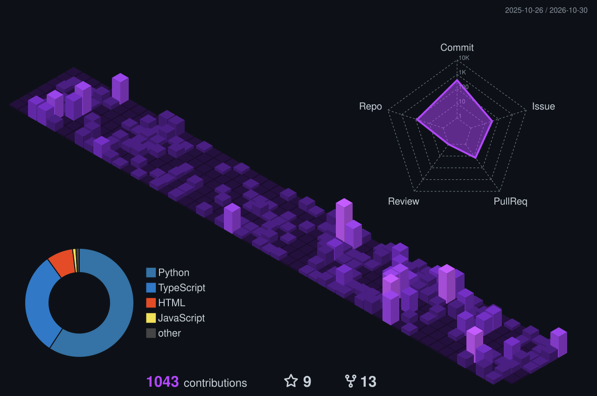

  <table>
    <tr>
      <td align="center" width="50%">
        
      </td>
      <td align="center" width="50%">
        
      </td>
    </tr>
    <tr>
      <td align="center">
        
      </td>
      <td align="center">
        
      </td>
    </tr>
  </table>

  

  

### 📈 3D Contribution Calendar

  

**[🎨 Projects](#user-content-featured-projects) &nbsp;·&nbsp; [🌐 Connect](#user-content-connect-with-me) &nbsp;·&nbsp; [🛠️ Tech Stack](#user-content-tech-stack) &nbsp;·&nbsp; [💬 Let's Talk](#user-content-lets-connect)**

### 🎨 Featured Projects

<table>
  <tr>
    <td align="center" width="50%">
      
    </td>
    <td align="center" width="50%">
      
    </td>
  </tr>
  <tr>
    <td align="center" width="50%">
      
    </td>
    <td align="center" width="50%">
      
    </td>
  </tr>
</table>

### 🌐 Connect With Me

  
  
  

### 🛠️ Technology Stack

  <table>
    <tr>
      <td align="center" width="33%">
        <h3>💻 Programming Languages</h3>
        
      </td>
      <td align="center" width="33%">
        <h3>🌐 Frontend & Web</h3>
        
      </td>
      <td align="center" width="33%">
        <h3>⚙️ Backend Development</h3>
        
      </td>
    </tr>
    <tr>
      <td align="center" width="33%">
        <h3>📱 Mobile Development</h3>
        
      </td>
      <td align="center" width="33%">
        <h3>🧠 AI & Machine Learning</h3>
        
         
        
        
        
        
      </td>
      <td align="center" width="33%">
        <h3>🤖 AI Technologies & Agents</h3>
        
        
        
        
        
         
        
        
        
        
      </td>
    </tr>
    <tr>
      <td align="center" width="33%">
        <h3>🗄️ Databases</h3>
        
      </td>
      <td align="center" width="33%">
        <h3>☁️ DevOps & Cloud</h3>
        
      </td>
      <td align="center" width="33%">
        <h3>🔐 Cybersecurity</h3>
        
         
        
        
        
        
      </td>
    </tr>
    <tr>
      <td align="center" colspan="3">
        <h3>🧰 Development Tools</h3>
        
      </td>
    </tr>
  </table>

  

### 💬 Let's Connect and Build Something Amazing Together!
